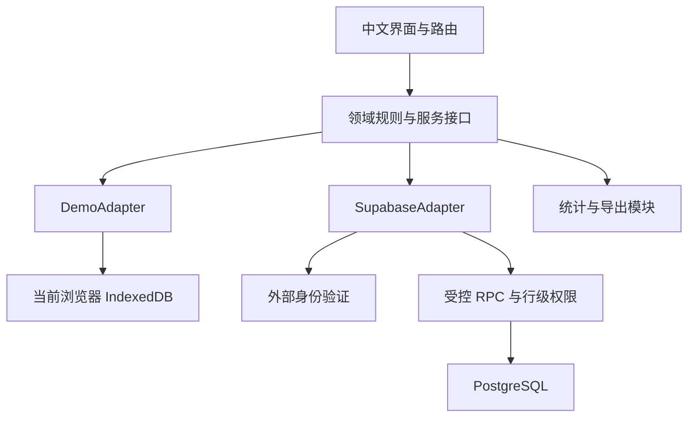

# 03 · 技术架构

## 1. 架构决定

采用浏览器应用，前端使用 `React + TypeScript + Vite`。GitHub Pages 发布完整演示；正式真实应用复用前端，连接 `Supabase Auth + PostgreSQL`，部署边界见 [09](09-deployment-and-operations.md)。前端业务通过同一套服务接口访问数据，分别提供 `DemoAdapter` 和 `SupabaseAdapter`。

原稿的 `Gradio + SQLite + Python` 适合另行运行的服务器应用，不能直接变成 GitHub Pages 的应用后端。浏览器运行的 SQLite/WASM 同样不能单凭自身形成可信的共享数据库。因此 V1 不使用上述组合作为网站主架构。Pages 的静态托管事实见 [资料 GH1](12-decisions-and-references.md)。



## 2. 依赖选择

| 职责 | 默认选择 | 约束 |
| --- | --- | --- |
| 界面与类型 | React、TypeScript | 不引入服务端渲染，静态构建可直接托管 |
| 开发与构建 | Vite、pnpm | 使用一份锁文件，记录实际工具版本 |
| 路由 | React Router 的哈希路由 | 不依赖服务器 URL 重写 |
| 图表 | Apache ECharts | 懒加载；统一配置入口；同时显示数据表 |
| 配置结构校验 | Ajv，使用 JSON Schema 2020-12 | 再执行跨字段语义校验，不能只过 Schema |
| Excel | 一个同时支持浏览器读取/写入 `.xlsx` 的库，默认 ExcelJS | 实施时核实版本、许可证与浏览器构建；不同时装多套同类库 |
| 演示持久化 | IndexedDB，可用小型 `idb` 包 | 事务写入；版本迁移失败明确报错 |
| 真实数据 | Supabase 官方 JavaScript SDK | Auth 与 RPC；前端仅有 publishable key |
| 自动验证 | Vitest、Playwright | 前端契约和真实用户流程；真实数据库权限另测 |

这里确定职责和选型，不把随时间变化的依赖版本写死成“最新”。T01 必须核对官方兼容要求，在 `package.json`、包管理器字段与锁文件中固定实际选用版本。禁止引入第二套 UI 框架、状态库或图表库解决同一职责。普通表单与局部状态先使用 React 能力。

本项目不需要 Python 才能运行 M1/M2。M3 如采用 Python 统计服务，环境选择必须遵循当时仓库适用的 `tenet-python-env-selection`，不可自行创建或修改环境。

## 3. 建议目录与职责

| 路径 | 职责 |
| --- | --- |
| `src/app/` | 应用入口、模式初始化、路由、页面壳和错误边界 |
| `src/features/auth/` | 演示身份、真实认证、首次建档、会话状态 |
| `src/features/experiments/` | 实验创建、配置预览、发布、关闭 |
| `src/features/assignments/` | 人员分配、任务列表、进度 |
| `src/features/responses/` | 表单、草稿、提交、退回、历史回执 |
| `src/features/analysis/` | 描述统计、图表、分析快照与进阶入口 |
| `src/features/files/` | Excel/JSON 导入、校验结果、导出和模板 |
| `src/domain/` | 数据类型、量程、完整性、状态迁移和错误契约 |
| `src/services/` | 本文档集定义的服务接口与依赖装配 |
| `src/adapters/demo/` | IndexedDB、演示会话、合成种子数据 |
| `src/adapters/supabase/` | RPC 映射、认证封装、错误转换 |
| `src/workers/` | 大文件解析、图表预计算和导出工作线程 |
| `src/components/` | 输入控件、提示、表格、通用空态等共享界面 |
| `supabase/migrations/` | 版本化建表、约束、权限和事务函数 |
| `tests/` | 自动化单元、契约、集成与浏览器测试 |
| `scripts/` | 实施时添加的构建、发布准备、资料校验入口 |
| `public/` | 公开静态资源；不得包含真实答卷或密钥 |
| `docs/` | 本套长期维护文档、契约、人工构造示例 |

不要为了符合目录表创建大量空文件；每项在对应任务实现时落地。自动测试使用 `tests/`；不创建根目录 `人工测试/`。临时测试产物按最新 Tenet 规范保存在当前派生工作区的 `本地测试留痕/<对象>/<任务>/`，确认被忽略，不提交 Git。

## 4. 模式与能力

构建配置 `VITE_APP_MODE` 只允许 `demo` 或 `live`，禁止根据网络请求失败自动推断。配置缺失是构建/启动错误；发布演示时显式选择 `demo`。

服务返回的 `Capabilities` 至少包含：

```ts
type Capabilities = {
  mode: 'demo' | 'live';
  persistence: 'browser' | 'server';
  verified_identity: boolean;
  shared_data: boolean;
  email_otp: boolean;
  inference: boolean;
  audit: 'local_demo' | 'server';
};
```

能力由已实现并验证的模块决定，不能只靠一个布尔值把占位页宣传成真功能。M1 必须已有表单、描述统计和真实文件下载。本版本的 M3 服务只接受真实模式中授权的服务端快照；演示模式固定 `inference=false`，进阶页说明未提供，不返回预制 `p` 值。真实模式在 M3 未实现或未通过验收时也为 `inference=false`。

同一部署只连接一种数据适配器。真实站点的“体验演示”链接打开独立的 Pages 演示地址；不把真实身份、令牌或答卷带过去。若将来同一站点支持双模式，必须另行实现显式重新初始化和存储隔离。

## 5. 服务分层

界面不直接读写 IndexedDB、不直接拼 SQL、不在组件中实现统计公式。接口由 [05](05-api-contracts.md) 定义，适配器负责持久化与错误映射；领域规则尽量复用。

浏览器校验用于快速反馈，真实后端必须独立校验身份、角色、量程、必答、实验开放状态和版本。即使前后端共用类型，也不能跳过后端权限检查。

真实写入经数据库事务 RPC：锁定目标状态、验证当前版本、验证业务条件、写入、记录审计、返回回执。参与者不获得修改提交历史、角色或发布快照的直接表权限。若实现受权函数，必须满足 [08](08-security-and-privacy.md) 的函数授权规范。

读取统一经有限字段的 RPC/安全视图，评价员只获取其已获分配的配置投影；管理员配置中的真实样品名称不可先下载再在界面隐藏。统计和导出同样检查管理员权限。

## 6. 演示数据层

数据库名固定前缀 `questionnaire:demo:v1`，记录种子版本和 Schema 版本。身份切换共享同一浏览器的演示实验与答卷，模拟管理员和评价员共同操作；每位访客的浏览器彼此独立。

IndexedDB 同一事务内维护答卷、修订与审计，不把多次独立写入当成原子提交。跨标签页变更可以通过 `BroadcastChannel` 通知刷新，但冲突判定仍以数据库中的 `edit_version` 为准。演示会话放 `sessionStorage`，不同标签页可分别扮演不同身份。

浏览器清理、隐私模式、配额不足均可能导致本地数据丢失或写入失败，不能承诺永久保留。存储不可用时显示阻断说明与导出未保存内容入口，不再显示“已保存”。依据见 [资料 WEB1](12-decisions-and-references.md)。

## 7. 分析与导出边界

描述统计使用已授权、已冻结的数据快照在浏览器计算。Excel 读取/写入与较大计算放工作线程，取消操作可终止线程。M3 推断分析由受控分析服务执行；浏览器提供交互和结果展示。

每份分析记录 `snapshot_id`、输入指纹、有效提交修订集合、方法与版本、计算时间、运行模式。输入变化不会修改已生成结果，只标记结果过时。统计输入来自服务器认可的当前提交，不能拿未提交草稿作正式分析。

## 8. 故障边界

| 故障 | 处理 |
| --- | --- |
| 认证过期 | 暂停请求，提示重新登录，内存编辑内容保留；重新读版本后保存 |
| 数据服务故障 | 显示失败与重试；不切换演示、不产生假回执 |
| 保存冲突 | 返回 `VERSION_CONFLICT`，让用户比较并决定，不最后写入者无声覆盖 |
| 文件解析失败 | 不创建实验；逐项展示格式错误 |
| 统计条件不满足 | 返回结构化不可计算原因；描述统计仍可用 |
| 前端缓存与新版本不一致 | 提示重新加载；禁止猜测迁移真实服务数据 |

V1 不添加 Service Worker、离线提交队列或前端多仓库微前端。没有这些复杂度也能完成当前需求。
