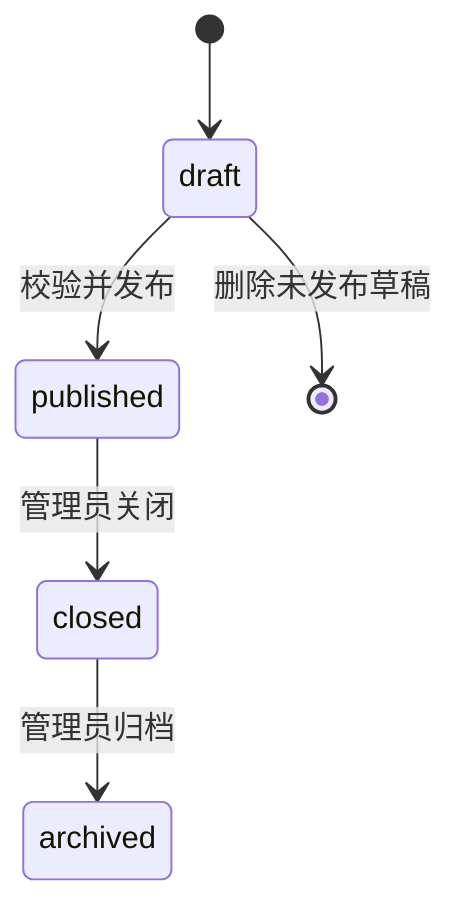
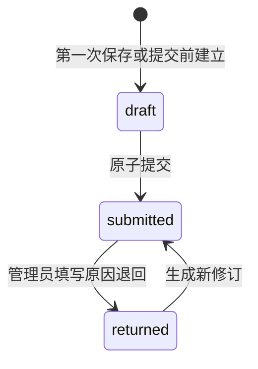

# 04 · 数据模型与状态机

## 1. 标识、时间与数值

业务实体使用服务端生成的 UUID。配置内的 `sample_id`、`indicator_id`、`text_question_id` 使用稳定短标识，只在一份配置中唯一；显示编码和名称不作为主键。前端字段与 JSON 统一使用 `snake_case`。

时间持久化为 UTC，API 使用带时区的 ISO 8601 字符串。界面按实验 `time_zone` 展示，V1 固定为 `Asia/Shanghai`。真实模式的开放时间、提交时间以服务端时钟为准；演示模式使用设备时钟并标注演示。

数值最多两位小数。后端使用精确十进制类型；前端先按十进制文本/精确十进制库校验精度，再转为百分刻度整数判断步长，避免直接用二进制浮点乘除或取模决定是否合法。具体规则见 [06](06-configuration-format.md#23-数值指标)。内部保存原始分数，显示时再格式化；统计前不四舍五入。

## 2. 实体清单

| 实体/建议表 | 主键、唯一约束 | 主要字段与职责 |
| --- | --- | --- |
| `profiles` | `user_id` 对应真实 Auth UUID | `display_name`、`participant_code`、`state=pending_consent/active/disabled`、`edit_version`、`consent_version`、`consented_at`；站内身份，不存密码 |
| `user_roles` | `user_id` 唯一 | `role=admin/participant`；只有可信管理流程能修改 |
| `experiments` | `experiment_id` | `status`、`draft_config`、`config_version_id`、`edit_version`、`data_revision`、`created_at`、`published_at`、`closed_at`；关闭时间由关闭事务写入 |
| `experiment_versions` | `config_version_id`；`experiment_id + version_no` 唯一 | 发布时不可变的完整配置 JSON、规范化哈希、发布者、`privacy_notice_version`、`retention_policy`；后两项来自站点已配置策略，不受任意导入文件控制 |
| `assignments` | `assignment_id`；`experiment_id + user_id` 唯一 | `state=active/revoked`、`edit_version`、配置版本、分配/撤销时间、`privacy_notice_version`、`consented_at`；包含管理员作为评价员的任务 |
| `responses` | `response_id`；`assignment_id + sample_id` 唯一 | 当前状态、`draft_answers`、`edit_version`、`latest_revision_id`、最近退回原因 |
| `response_revisions` | `revision_id`；`response_id + revision_no` 唯一 | 不可变的每次完整提交：全部题目答案、配置版本、提交人、时间、幂等键 |
| `audit_events` | `event_id` | 操作人、动作、对象、时间、原因、请求号；不复制整份答卷/令牌 |
| `idempotency_requests` | `actor_id + operation + idempotency_key` 唯一 | 请求摘要、业务结果引用；防止同一操作重放产生副作用 |
| `analysis_snapshots` | `snapshot_id` | 选定实验、输入修订集合、纳入/排除清单、数据版本、方法配置、输入哈希、结果状态 |
| `deletion_requests` | `request_id` | 用户的数据删除请求、处理状态、完成时间；不对外显示其他人请求 |

发布配置为一个不可变聚合；首版无需额外拆出 `indicators`、`samples` 数据表。后端必须从冻结配置验证每个样品和题目引用。若后续为查询性能拆表，配置快照仍是历史解释依据，不能读取后来改动的定义解释旧数据。

`experiments.draft_config` 使用 [06](06-configuration-format.md#26-编辑草稿) 的 `DraftExperimentConfig`，允许尚未填完的标题、列表与量程；发布时必须转为完整 `ExperimentConfig` 并通过正式 Schema 和语义校验。保存草稿不等于配置已经可发布。

所有关联检查都需验证属于同一实验、同一配置版本。仅存在某个 UUID 不代表可以与任意实验组合。查询索引至少覆盖用户任务、实验任务、样品答卷和最新提交修订。

Auth 验证完成后，可信初始化流程创建 `participant` 角色及 `pending_consent` 资料；用户完成站点告知与昵称设置后转为 `active`。开始每个实验前还需接受该冻结版本的实验告知，由本人调用受控函数记录任务的同意版本和时间。未同意可读说明，不能保存或提交答卷。默认保留与到期处置见 [08](08-security-and-privacy.md)，到期不能继续收集。

## 3. 数据对象

```ts
type NumericAnswer = {
  indicator_id: string;
  value: number | null;
  missing_reason: string | null;
};

type TextAnswer = {
  text_question_id: string;
  value: string;
};

type Answers = {
  numeric: NumericAnswer[];
  text: TextAnswer[];
};

type ResponseState = 'draft' | 'submitted' | 'returned';
type SubmissionReceipt = {
  response_id: string;
  revision_id: string;
  revision_no: number;
  submitted_at: string;
  edit_version: number;
};
```

草稿允许缺项；提交时每个数值指标和文字题必须恰好出现一次，未知 ID、重复 ID 被拒绝。可选数值题未填用 `value=null, missing_reason=null`；选择“无法评价”用 `value=null` 加非空原因；有分数时原因必须为空。必答数值题仅在其 `allow_not_evaluable=true` 时可用原因替代分数。

文字答案可保留换行和标点；提交校验以去除首尾空白后判断是否为空，但保存原文。最大字符数按 Unicode 码点计数，不按 UTF-16 代码单元计数。原始文本按普通文本显示。

## 4. 实验状态



| 状态 | 配置修改 | 分配与撤销 | 草稿保存/提交/退回 | 查询和导出 |
| --- | --- | --- | --- | --- |
| `draft` | 允许 | 不允许 | 不允许 | 管理员预览；配置完整合法后才允许正式配置导出 |
| `published` 且开放时间内 | 不允许 | 允许 | 允许，仍须检查任务和账户状态 | 按角色权限 |
| `published` 尚未开放/已过期 | 不允许 | 允许分配；撤销允许 | 不允许 | 按角色权限 |
| `closed` | 不允许 | 不允许新增/恢复；可撤销 | 不允许 | 按角色权限，只读 |
| `archived` | 不允许 | 不允许 | 不允许 | 管理员可查；本人历史记录仍可查 |

时间窗是答卷采集的额外条件，不靠后台定时器改状态。服务端在每次保存答卷草稿、提交或退回时检查 `opens_at <= now < closes_at`；空边界不增加该端日程限制，但仍受 [08](08-security-and-privacy.md) 的保留策略约束，无截止实验默认最多采集至发布后 `365` 天。任务分配、撤销、关闭、归档等管理操作按上表及各接口自身规则执行，不套用所有写操作必须在采集时间内的限制；恢复任务另外要求实验当前开放。截止时状态可仍为 `published`，UI 显示“已截止”。V1 不重新开放已关闭实验，也不修改已发布截止时间；需要新一轮时复制为新实验。

删除只针对未发布且无关联业务数据的草稿。正式数据删除走受控隐私流程，不能把“归档”当成已经清除个人数据。

## 5. 任务与答卷状态

任务只有 `active/revoked` 存储状态；展示用的“未开始/进行中/已完成/有退回”由样品答卷计算，不单独维护易失真的计数。



`returned` 状态下保存草稿仍保持 `returned`，直到重新提交。提交状态禁止改草稿。退回时从最新修订初始化可编辑草稿，历史修订不改。管理员不能代替评价员更改评分。

进度分母为冻结配置的样品数量，分子为当前处于 `submitted` 的样品数量。只有全部样品已提交才展示“已完成”；退回一个即不再完成。

撤销任务立即禁止业务写入，当前统计排除该任务的全部记录；恢复沿用同一任务与历史。

任何改变分析快照输入、纳入/排除清单或任务覆盖情况的事务都必须递增实验 `data_revision`，以便标记旧分析过时。包括新增任务、首次创建答卷草稿使“未开始”变成“进行中”、新的有效提交、退回、任务撤销/恢复、账户停用/恢复。一个事务对同一实验递增一次；账号状态变更涉及多个实验时更新全部受影响实验。

已有 active 任务的重复分配、幂等重放，以及只修改未纳入快照的草稿答案且未改变覆盖状态的保存，不增加 `data_revision`。草稿自身的 `edit_version` 仍按并发规则更新。分析快照不冻结未提交的草稿内容或其每次编辑时间，避免把无关编辑当成统计输入变化。

## 6. 并发与幂等

`edit_version` 从 `1` 开始。创建答卷时客户端发送 `expected_version=0` 表示预期不存在；已存在记录的每次成功保存、提交或退回均加一。请求的 `expected_version` 不相等时返回 `VERSION_CONFLICT` 和最新版本，不自动合并不同设备的分数。

提交、发布、分配、撤销、退回、关闭和归档均带客户端生成的 UUID `idempotency_key`。同一操作、身份、键与相同规范化请求摘要重试，返回原业务结果；相同键而内容不同返回 `IDEMPOTENCY_CONFLICT`。保留幂等记录至对应实验被受控删除，不能用短缓存让迟到重试产生新修订。

已成功请求的重复返回不产生新写入。返回前仍需确认调用者当前有读取结果的权限；账户停用或授权撤销后可以拒绝访问，但不能重做操作。首次请求与截止/关闭/撤销并发时，事务锁和服务端状态决定唯一结果。

真实提交事务顺序：验证当前身份和角色 → 查询幂等结果 → 锁定实验、任务和答卷 → 检查开放与版本 → 验证全部答案 → 追加不可变修订 → 更新答卷状态及版本 → 更新 `data_revision` → 写审计/幂等记录 → 返回回执。各函数按同一锁顺序取锁，避免交叉死锁。

## 7. 统计数据集

默认纳入满足以下全部条件的记录：账户激活、任务 `active`、答卷当前 `submitted`、最新修订与冻结配置一致。一次分析只使用每个“评价员 × 样品”的最新有效修订。实验已关闭或归档不影响分析其有效历史数据。

旧修订、草稿、退回中、撤销任务和停用账户分别计入排除原因，不能悄悄丢弃。描述统计按各样品各指标的实际非缺失值计算；配对分析另按指标形成完整评价员集合，详见 [07](07-statistical-analysis.md)。

创建分析快照的读取必须基于同一数据库一致性快照，包含 `data_revision` 和每个 `revision_id`；读取到半旧半新的行集后再补一个当前版本号是不合格实现。浏览器一次导出复用此快照，不边导出边重新读取不同时间的数据。

## 8. 配置投影与保密边界

管理员获取完整冻结配置；评价员只获取作答必需字段。参与端始终不返回 `admin_name`；`display_sample_names=true` 时只允许返回公开的 `display_name`，为 `false` 时连该字段也不返回。管理员身份资料与其他人的答案也不返回。不要依靠 CSS 隐藏或前端删除已经下载的敏感字段。

真实联系邮箱由 Auth 持有，不在公开配置或分析输出中复制。默认导出使用 `participant_code`。编码可被管理员关联到个人，因此是去标识化，不是严格匿名。
